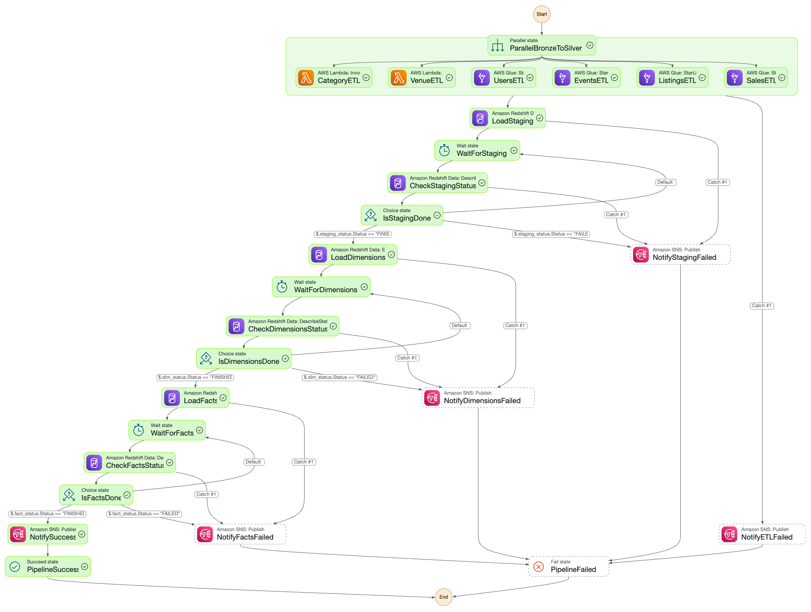

# TICKIT V2 architecture

The V2 warehouse uses S3 Bronze CSVs, Silver Parquet, and a Redshift Serverless dimensional model in `us-east-1`, targeting the `tickit_v2` database. [Verified metrics](VERIFIED_METRICS.md) records the manually checked deployment results and their limits; repository changes do not establish deployment parity.

## Data flow and job selection

| Dataset | ETL runtime | Silver destination |
|---|---|---|
| Category, venue | Lambda | `tickit-v2/silver/category/`, `tickit-v2/silver/venue/` |
| Users, events | Glue Python Shell with pandas | `tickit-v2/silver/users/`, `tickit-v2/silver/event/` |
| Listings, sales | Glue Spark | `tickit-v2/silver/listing/`, `tickit-v2/silver/sales/` |

The source scripts read `bronze/` CSVs. Lambda handles the two small reference datasets, Python Shell handles users and event enrichment, and Spark handles the larger transaction datasets. Events are enriched from Bronze venue and category lookups, so that branch does not depend on their Silver outputs.

The recorded Events job used 1 DPU; the recorded Listings job used ten G.1X workers. Worker settings belong to deployed Glue job configuration, not the workflow template. No measured cost savings or complete pipeline runtime has been established.

## Orchestration

`stepfunctions/tickit_pipeline_v2.template.json` is the single workflow source. [Configuration instructions](STEP_FUNCTIONS_PARAMETERIZATION.md) describe rendering resource identifiers and wait times into a deployment definition.

The workflow runs six ETL branches in parallel. Lambda tasks wait for invocation responses; Glue tasks use `glue:startJobRun.sync`. Once all branches complete, Redshift Data API calls load staging, dimensions, and facts in sequence. Each statement is polled: `FINISHED` advances, `FAILED` or `ABORTED` captures an error, and other statuses continue polling. SNS reports success or failure; the workflow has an overall timeout.

The graph below is an older visualization of the broad flow. It omits the current error-capture states, and its green execution markers are not evidence of a successful V2 run. The JSON template is authoritative.

A successful full V2 execution and schedule/trigger integration have not been verified. `lambda/s3_trigger.py` accepts the exact `bronze/.done` marker and uses a stable daily execution name. Its overlap check skips a marker while another execution runs; it does not queue that delivery for replay.

## Warehouse model and loading

Staging has six source-aligned tables. The repository staging procedure uses `DELETE` followed by Parquet `COPY` within the procedure transaction, loading from `tickit-v2/silver/`.

`dim.event` embeds venue and category attributes. `dim.users` serves both seller and buyer roles through surrogate keys in the facts. This reduces the number of joins needed to access event attributes; no query-speed improvement is claimed without execution-plan and timing evidence.

The date loader separately initializes 2,556 event-calendar records: source keys 1827–4382 map to 2008-01-01 through 2014-12-30. The workflow does not initialize this table. Source `dateid` describes the event date; transaction trends use `saletime` or `listtime`. The monthly sales view groups on `saletime`.

The fact procedure resolves current dimension versions and skips natural keys already loaded with `NOT EXISTS`. This supports sequential reruns; it does not guarantee uniqueness across concurrent writers or update previously loaded transactions.

## Dimension history and deployment differences

User and event dimensions have `effective_date`, `expiry_date`, and `is_current` columns. The repository dimension procedure contains daily SCD2 change detection, while the last verified deployed procedure only inserted keys lacking a current row. Reconcile these definitions before redeployment or claiming automatic history tracking.

The fact loader uses current dimension versions rather than point-in-time lookups. A surrogate key therefore preserves the version assigned at load time, which may differ from the version effective at a historical transaction timestamp. Same-day changes and historical reprocessing need additional temporal design.

## Physical layout

The repository DDL distributes staging tables evenly, replicates `dim.date` with `DISTSTYLE ALL`, and distributes facts and `dim.event` by `eventid`. `dim.users` distributes by `userid`. Facts sort by `(dateid, eventid)`; user/event dimensions sort by natural key and effective date.

Distribution choices express the intended layout, not a verified guarantee of local joins. Reporting views join on surrogate keys, so matching `eventid` distribution alone does not establish their execution plans. The fact sort key follows event dates rather than transaction timestamps.

## Operational boundaries

The repository DDL includes destructive table recreation and is intended for initialization. The recorded V2 deployment was initialized manually before warehouse loading. ETL scripts replace shared Silver paths; they do not publish all six datasets as one atomic snapshot. Versioned batch prefixes and a commit manifest would be needed for that guarantee.

The workflow needs permissions for its configured Lambda functions, Glue jobs, Redshift Data API calls, and SNS topic. ETL needs access to its Bronze and Silver objects, and Redshift needs read access for COPY. The repository does not establish a complete reproducible IAM deployment.

Offline tests check transformations, trigger handling, SQL safeguards, template rendering, and workflow references. They do not execute Spark jobs or Redshift SQL and do not verify live AWS integration.
